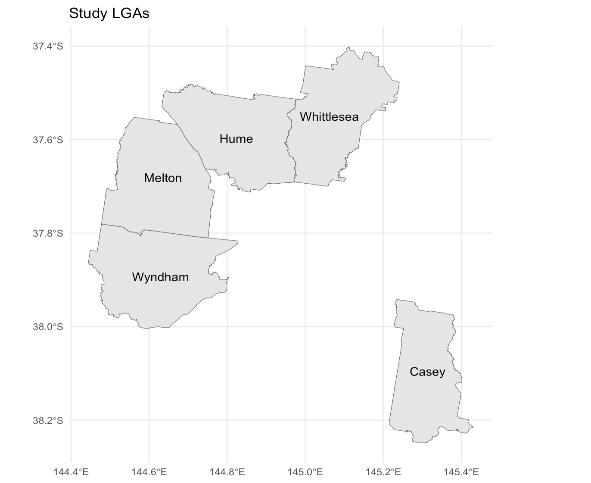
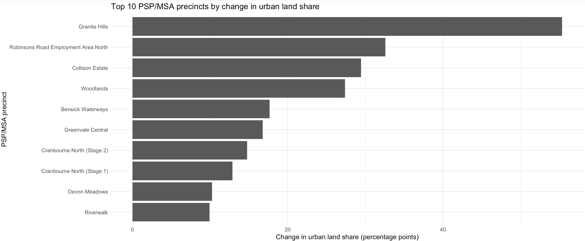
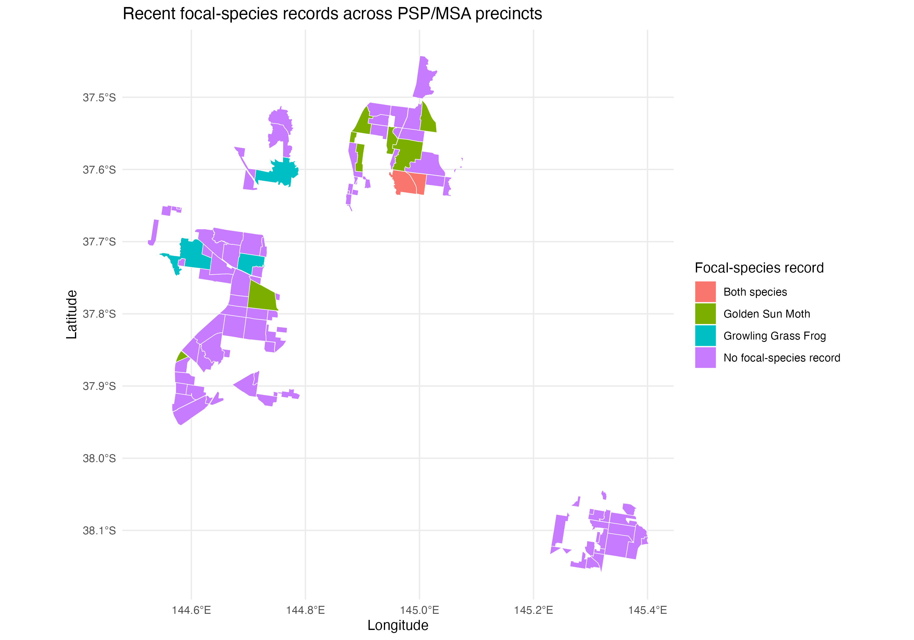
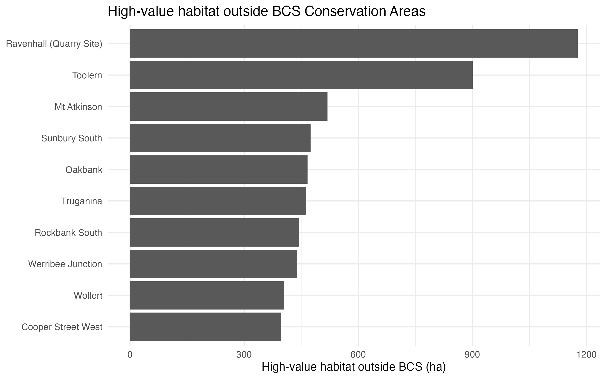
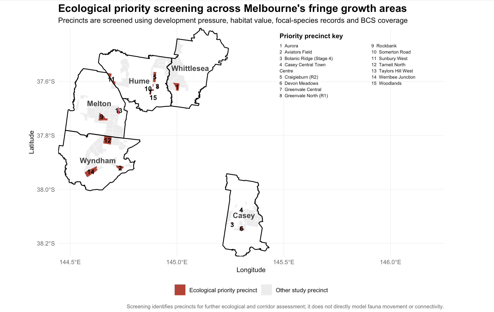
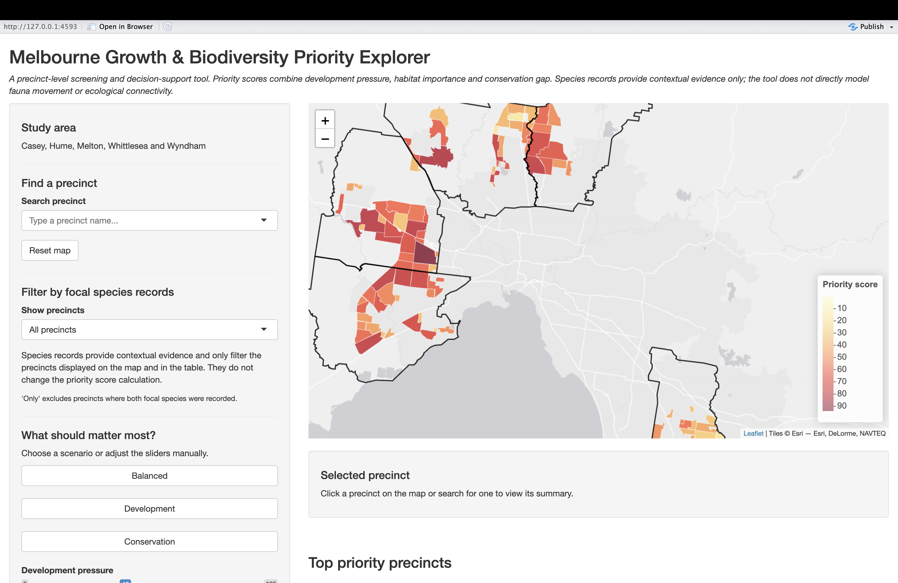

## The problem and research question

Melbourne's fringe growth areas are experiencing rapid urban expansion, increasing pressure on native habitat and ecological connectivity.

### Original project question

**How is rapid housing expansion in fringe growth corridors encroaching on native fauna movement, and where are priority ecological corridors in need of planning overlay protection?**

### Our analytical scope

**Precinct-level ecological screening of where development pressure, ecological value and conservation gaps overlap**

*Fauna movement and habitat connectivity are not directly modelled.*

## Study area and planning relevance

::: {.columns}

::: {.column width="55%"}

{width=100%}

:::

::: {.column width="43%"}

### Study area

**5 fringe-growth LGAs**

Casey · Hume · Melton · Whittlesea · Wyndham

**105 PSP/MSA precincts**

### Why it matters

The screening can support:

- state and local planners
- growth-area planners
- councils
- biodiversity teams

by highlighting precincts requiring closer ecological assessment.

:::

:::

## Data and analysis framework

::: {.columns}

::: {.column width="42%"}

### Data

- **Land cover**  
  Urban expansion

- **Habitat Value raster**  
  High-value habitat

- **Species records**  
  Golden Sun Moth  
  Growling Grass Frog

- **BCS Conservation Areas**  
  Conservation coverage

:::

::: {.column width="56%"}

### Screening framework

**Development pressure**  
Urban growth and urban-share change

**Ecological value**  
High-value habitat and focal-species evidence

**Conservation gap**  
BCS conservation coverage

### ↓

### **Ecological priority screening**

### ↓

**Priority precincts for further ecological and corridor assessment**

:::

:::

## Urban expansion: approach and findings

::: {.columns}

::: {.column width="38%"}

### Development pressure

Measured using:

**Urban growth (ha)**  
Absolute increase in urban land

**Urban-share change**  
Change in the proportion of each precinct classified as urban

### Result

**63 / 105 precincts**

were classified as having **high development pressure**.

:::

::: {.column width="60%"}

{width=100%}

:::

:::

**Median thresholds:** 6.12 ha growth · 1.58 percentage-point share change

## Habitat, focal species and conservation analysis

### We examined three ecological indicators across the 105 precincts

::: {.columns}

::: {.column width="32%"}

### 1. Habitat

We measured the **percentage of each precinct covered by high-value habitat**.

**High-value habitat:**  
Habitat Value ≥ 70

:::

::: {.column width="32%"}

### 2. Focal species

We checked recent records of:

**Golden Sun Moth**

**Growling Grass Frog**

Species records show **where the species were observed**, not their abundance.

:::

::: {.column width="32%"}

### 3. Conservation gap

We calculated the amount of **high-value habitat outside BCS Conservation Areas**.

A larger area indicates a larger **potential conservation gap**.

:::

:::

**Together, these measures help identify where ecological value may require closer planning attention.**

## Habitat and focal-species findings

::: {.columns}

::: {.column width="38%"}

### High-value habitat

Across the **105 precincts**, we identified:

### **17,172 ha**

of **high-value habitat**

*Habitat Value ≥ 70*

### Focal-species records

**Golden Sun Moth**  
2,899 recent records

**Growling Grass Frog**  
344 recent records

At least one focal species was recorded in only:

### **13 of 105 precincts**

:::

::: {.column width="60%"}

{width=100%}

:::

:::

*Species records show observed occurrence — not abundance, and no record does not mean the species is absent.*

## Most high-value habitat lies outside BCS Conservation Areas

::: {.columns}

::: {.column width="40%"}

### **82.2%**

of the **high-value habitat** identified across our 105 precincts lies **outside BCS Conservation Areas**.

**17,172 ha**  
total high-value habitat

**14,113 ha**  
outside BCS areas

**3,059 ha**  
inside BCS areas

:::

::: {.column width="58%"}

{width=95%}

:::

:::

### What does this tell us?

The conservation gap is **not evenly distributed**. Precincts such as **Ravenhall (Quarry Site), Toolern and Mt Atkinson** contain some of the largest areas of high-value habitat outside BCS areas.

*Outside BCS does not mean completely unprotected. It only means the habitat falls outside this specific conservation layer.*

## Ecological priority screening

### A precinct is flagged only when all three conditions are met

::: {.columns}

::: {.column width="30%"}

### High development

Urban growth  
**above median**

**OR**

Urban-share change  
**above median**

:::

::: {.column width="5%"}

   

**AND**

:::

::: {.column width="30%"}

### High ecological value

High-value habitat  
**above median**

**OR**

Focal species  
**present**

:::

::: {.column width="5%"}

   

**AND**

:::

::: {.column width="30%"}

### No BCS coverage

**0%**

of the precinct covered by BCS Conservation Areas

:::

:::

 

### ↓

### **Ecological priority precinct**

## Priority screening results

::: {.columns}

::: {.column width="26%"}

### **15**

ecological priority precincts were identified across the five study LGAs.

These precincts combine:

- relatively high development pressure
- ecological value
- no BCS coverage

They are **screening priorities**, not confirmed ecological corridors.

:::

::: {.column width="72%"}

{width=100%}

:::

:::

## From priority screening to interactive exploration

::: {.columns}

::: {.column width="47%"}

### Fixed ecological screening

Used to identify the **15 priority precincts**.

A precinct is flagged when it has:

- high development pressure
- high ecological value
- no BCS conservation coverage

This gives a clear **YES / NO screening result**.

:::

::: {.column width="47%"}

### Interactive Priority Explorer

The Shiny tool goes one step further by **ranking all 105 precincts**.

It combines:

- **Development pressure**
- **Habitat importance**
- **Conservation gap**

Users can change the weights to explore different planning scenarios.

**Species records are used as a filter and contextual evidence, they do not change the score.**

:::

:::

**Screening identifies where concern overlaps. The Explorer helps compare how strongly precincts should be prioritised under different planning objectives.**

## Interactive Priority Explorer

::: {.columns}

::: {.column width="68%"}

{width=100%}

:::

::: {.column width="30%"}

### Explore priorities

- Search individual precincts
- Compare planning scenarios
- Adjust component weights
- View ranked precincts
- Filter by focal-species records

### Scenarios

**Balanced**  
Equal emphasis

**Development-focused**  
More weight on development pressure

**Conservation-focused**  
More weight on habitat and conservation gap

:::

:::

<a href="http://127.0.0.1:4593" target="_blank">
Open Interactive Priority Explorer →
</a>

*Priority scores are relative rankings among the 105 precincts, not ecological-risk probabilities.*

## Key findings and planning implications

### Three messages emerge from the analysis

**1. Urban expansion pressure is spatially uneven**  
Some fringe precincts are experiencing substantially stronger development pressure than others.

**2. Ecological value and conservation coverage do not always align**

A large share of high-value habitat lies outside BCS Conservation Areas, while focal-species records are concentrated in a relatively small number of precincts.

**3. Priority emerges from overlap**

The strongest concern occurs where:

**development pressure + ecological value + no BCS coverage**

overlap in the same precinct.

### Planning implication

The 15 screened precincts provide a focused starting point for more detailed ecological and corridor assessment.

## Limitations and future work

::: {.columns}

::: {.column width="48%"}

### Current limitations

- Fauna movement is **not directly modelled**
- Habitat connectivity is **not directly modelled**
- Species records indicate **occurrence**, not movement pathways or abundance
- BCS coverage is **not equivalent to statutory planning-overlay protection**

:::

::: {.column width="48%"}

### Next steps

- habitat-connectivity analysis
- road and infrastructure barriers
- statutory planning overlays
- potential ecological corridor identification

:::

:::

## Thank you

### Questions?