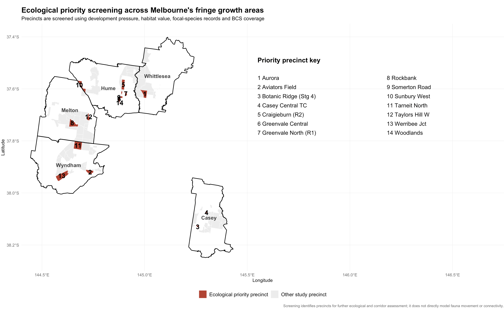
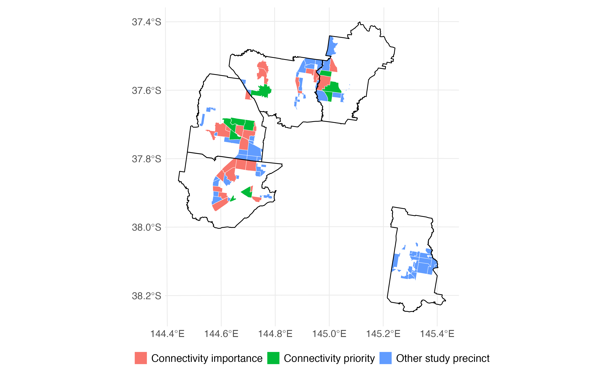
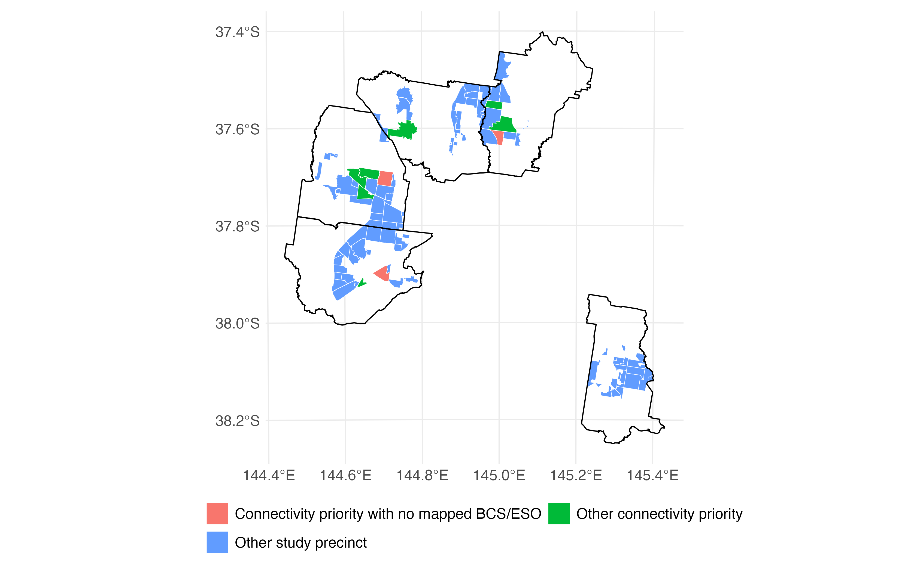

# Abstract

Rapid urban expansion across Melbourne’s fringe growth areas can increase pressure on native habitat through land conversion, fragmentation and reduced habitat connectivity. This project investigates where urban development pressure, biodiversity value and gaps in mapped conservation coverage overlap across 101 PSP/MSA precincts in Casey, Hume, Melton, Whittlesea and Wyndham. The analysis integrates land-cover change, Habitat Value, recent Golden Sun Moth and Growling Grass Frog occurrence records, Biodiversity Conservation Strategy (BCS) Conservation Areas and Environmental Significance Overlays (ESO).

Development pressure and ecological value were first combined in a transparent rule-based screening, while a separate structural connectivity analysis assessed habitat fragmentation, major habitat patches, patch separation and development pressure. Across the study area, 63 of 101 precincts were classified as having high development pressure. Approximately 17,172 ha of high-value habitat was identified, of which 82.2% lay outside BCS Conservation Areas. The baseline screening identified 14 ecological priority precincts, while the structural connectivity analysis identified 10 potential connectivity priorities. Of these, three had no mapped BCS or ESO coverage, two contained focal-species records, and one combined connectivity concern, focal-species evidence and no mapped BCS/ESO coverage.

An Interactive Priority Explorer was also developed to support comparison of precincts under different planning priorities. The results provide a screening basis for targeted ecological assessment and planning review rather than confirmed wildlife-corridor identification.

# Introduction

## Background and motivation

Melbourne's continued urban growth has increased pressure on land at the metropolitan fringe, where new development can overlap with areas of ecological importance. Urban sprawl, characterised by the outward expansion of developed land, can alter natural habitats and contribute to their fragmentation. As habitats become smaller and more isolated, the spatial connections between them may also be affected.

Habitat fragmentation is an important biodiversity concern because smaller and more isolated habitat patches can make it harder for species to maintain viable populations. Previous research has demonstrated that fragmentation can reduce biodiversity and affect ecological processes over time (Haddad et al., 2015). Maintaining connections between habitat patches is therefore an important consideration in conservation planning, particularly in areas experiencing continued development.

In Melbourne's growth corridors, urban development and biodiversity conservation are addressed through planning frameworks such as the Melbourne Strategic Assessment (MSA) and the Biodiversity Conservation Strategy (BCS). These frameworks aim to accommodate urban growth while addressing impacts on threatened species and habitats. However, understanding where development pressure, ecological value and existing conservation coverage overlap remains important for identifying locations that may require closer assessment.

This project examines these issues across Melbourne's growth corridors by combining historical urban land-cover change, habitat value, focal-species records and planning protection data. Rather than attempting to confirm actual wildlife movement corridors, the study aims to identify precincts where ecological and planning concerns overlap and where further investigation of habitat connectivity may be useful.

## Research question and objectives

The main research question is:

Where do urban development pressure, biodiversity value and conservation gaps overlap in Melbourne's growth corridors, and which precincts warrant further assessment of habitat connectivity and planning protection?

To address this question, the study has four objectives:

1. Assess urban development pressure by examining historical changes in urban land cover across the study precincts.

2. Evaluate ecological value using habitat-value data and focal-species occurrence records.

3. Identify ecological priorities through separate assessments of baseline development–conservation overlap and structural habitat connectivity.

4. Examine planning protection coverage using BCS Conservation Areas and Environmental Significance Overlays (ESOs), and develop an interactive tool to support the exploration of priority precincts.

The analysis is conducted at the PSP/MSA precinct level across five growth-area LGAs. The resulting priorities are intended to support further ecological investigation and planning review, rather than confirm wildlife movement corridors or determine final protection boundaries.

# Study Area and Planning Context

## Study area

The study focuses on five local government areas (LGAs) within Melbourne's urban growth corridors: Casey, Hume, Melton, Whittlesea and Wyndham. These areas were selected because they are located along Melbourne's metropolitan fringe, where urban expansion and biodiversity conservation are important planning considerations.

The analysis uses Precinct Structure Plan (PSP) and Melbourne Strategic Assessment (MSA) precincts as its main spatial units. Compared with broader LGA-level summaries, precinct-level analysis provides a more localised basis for examining development pressure, ecological value and planning protection coverage.

A total of 101 PSP/MSA precincts were retained for the analysis. The same analytical units were used throughout the development-pressure, ecological-value and connectivity assessments, allowing the different screening results to be compared consistently. The spatial distribution of the five study LGAs is shown in @fig-study-area.

{#fig-study-area}

## Planning and conservation context

Urban development in Melbourne's growth corridors is guided by several planning and conservation frameworks. The Urban Growth Boundary (UGB) defines the broad extent of metropolitan urban development and helps direct growth towards areas with appropriate infrastructure and services. It also aims to protect valuable land outside the boundary from urban development pressure (Victorian Planning Authority, n.d.).

The Melbourne Strategic Assessment (MSA) provides a framework for considering the environmental impacts of urban development in Melbourne's growth areas. It was undertaken under the Commonwealth Environment Protection and Biodiversity Conservation Act 1999 and established conservation commitments associated with planned urban expansion. The Biodiversity Conservation Strategy (BCS) for Melbourne's Growth Corridors forms part of this approach by identifying conservation priorities and measures intended to protect biodiversity while allowing planned development to proceed (Victorian Government, 2013).

At the local planning level, the Environmental Significance Overlay (ESO) is a statutory planning control used to identify land where development may be affected by environmental constraints. It aims to ensure that development is compatible with identified environmental values. The specific objectives and requirements depend on the relevant overlay schedule (Victorian Government, 2026).

These frameworks provide different forms of guidance and protection. The UGB directs the broader location of urban growth, the MSA and BCS address biodiversity conservation within planned growth areas, and the ESO applies environmental considerations through local planning schemes.

In this study, BCS Conservation Areas and ESO spatial layers were used to examine the extent of mapped conservation and planning coverage across the study precincts. Areas without mapped BCS or ESO coverage were treated as potential gaps requiring further investigation, rather than areas assumed to have no environmental protection.

# Data

## Urban development data

Urban development was examined using the Victorian Land Cover Time Series published by the Victorian Department of Energy, Environment and Climate Action (DEECA, n.d.). The dataset provides spatial information on land-cover patterns across Victoria, covering seven periods from 1985–90 to 2015–19. Each raster has a spatial resolution of 25 metres.

To measure urban land, we combined two land-cover classes: Built environment and Urban area. These classes were used as an indicator of developed land across the study area. Each raster cell represents 625 square metres, equivalent to 0.0625 hectares.

The land-cover data were analysed at two spatial scales. At the LGA level, they provided an overview of historical urban expansion across Casey, Hume, Melton, Whittlesea and Wyndham. At the PSP/MSA precinct level, they were used to calculate urban land area and compare development pressure across the 101 analytical precincts.

The main comparison used the earliest and latest periods, 1985–90 and 2015–19. These data capture changes in classified urban land cover but do not distinguish housing development from other urban land uses. Therefore, urban land-cover change was used as a proxy for broader development pressure rather than a direct measure of residential expansion.

## Habitat Value data

Habitat Value data were used to represent habitat importance across the study area. The analysis used a 75 m resolution Habitat Value raster (`habitat_value_75m_20241024_vg2020.tif`), with habitat information summarised for each of the 101 analytical PSP/MSA precincts.

Two precinct-level habitat measures were derived from the raster: mean Habitat Value and the percentage of each precinct containing high-value habitat. For this project, raster cells with a Habitat Value of 70 or above were classified as high-value habitat. The proportion of these cells within each precinct was then calculated as `high_habitat_percent`.

Habitat Value was included because it provides spatial evidence of ecological importance across the full study area, complementing the more location-specific focal-species occurrence records. The Habitat Value ≥ 70 threshold was used as an exploratory screening threshold to focus the analysis on relatively higher-value habitat while retaining enough spatial coverage for precinct-level comparison and connectivity analysis. It should therefore be interpreted as an analytical threshold used consistently across the study, rather than an official ecological or regulatory cut-off.

## Focal-species records

Focal-species occurrence data were used to provide species-specific biodiversity evidence alongside the broader Habitat Value measure. The final analysis focused on two species: the Golden Sun Moth and the Growling Grass Frog.

Species occurrence records were obtained from the Victorian Biodiversity Atlas (VBA). To focus the analysis on relatively recent occurrence evidence, only records from 2015 onwards were retained. This reduced the influence of older observations that may be less representative of current development and habitat conditions, while still preserving enough records for precinct-level comparison. The 2015 cut-off was used as a practical analytical choice rather than as an ecological threshold. The records were spatially matched to the 101 analytical PSP/MSA precincts, and the number of records for each focal species was calculated for every precinct.

The resulting variables, `golden_sun_moth_records` and `growling_grass_frog_records`, were used to determine whether focal-species evidence was present within each precinct. These records provide evidence of observed occurrence rather than estimates of population abundance or animal movement. Similarly, the absence of a record within a precinct should not be interpreted as evidence that the species is absent.

## Conservation and planning layers

Two mapped planning and conservation layers were incorporated into the analysis: Biodiversity Conservation Strategy (BCS) Conservation Areas and Environmental Significance Overlays (ESO).

BCS Conservation Areas were used to represent mapped conservation coverage within each analytical precinct. The percentage of each precinct covered by BCS was calculated as `bcs_percent`, allowing the analysis to distinguish between precincts with and without mapped BCS coverage.

Environmental Significance Overlays were used as an additional planning layer to capture areas subject to mapped environmental planning controls. ESO polygons within the study area were identified and summarised at precinct level, producing measures of ESO area, percentage coverage and whether an ESO was present.

Using both BCS and ESO allowed the project to compare ecological and connectivity priorities with two different forms of mapped conservation and planning coverage. However, the absence of BCS or ESO coverage should not be interpreted as the absence of all environmental protection, as these layers do not capture every possible planning or conservation mechanism.

## Spatial boundaries and analytical units

The spatial analysis used LGA boundaries, PSP polygons and MSA precinct records to establish a consistent set of analytical units. The five selected LGA boundaries were combined to define the overall study area.

PSP boundary names were standardised before being matched with the MSA precinct records. Of the 122 MSA records, 117 were successfully matched to spatial polygons. The matched precincts were transformed to the GDA94 / Vicgrid94 projected coordinate reference system (EPSG:3111) for spatial processing and area calculations.

The precinct polygons were then intersected with the combined five-LGA study area. Of the 117 matched precincts, 105 had some spatial overlap with the study area. For each precinct, the proportion of its original area within the study boundary was calculated.

Only precincts with at least 50% of their original area inside the five LGAs were retained. This excluded four precincts with marginal boundary overlaps, producing the final set of 101 analytical precincts.

The resulting precinct boundaries provided a common spatial framework for integrating urban land cover, Habitat Value, focal-species records, BCS Conservation Areas and ESO coverage. Both the baseline ecological screening and structural-connectivity assessment were conducted using these same analytical units.

# Methodology

## Development-pressure analysis

Urban development pressure was assessed at the precinct level using the Victorian Land Cover Time Series. We compared land-cover conditions between 1985–90 and 2015–19 to examine long-term urban expansion across the 101 analytical precincts.

Two complementary indicators were calculated. Urban growth (ha) measured the absolute change in urban land area between the two periods, while urban-share change (percentage points) measured the change in the proportion of each precinct classified as urban. Using both indicators allowed us to capture different patterns of development: larger precincts may experience substantial expansion in absolute terms, while smaller precincts may undergo a large proportional change despite gaining fewer hectares of urban land.

For each indicator, the median across the 101 precincts was used as a screening threshold. A precinct was classified as having high development pressure if either its urban growth or urban-share change exceeded the corresponding median. This OR condition was chosen to identify precincts showing substantial expansion on either measure, rather than requiring both conditions to be satisfied.

The median thresholds were 6.50 ha for urban growth and 1.62 percentage points for urban-share change. These thresholds provide a transparent and reproducible relative classification within the study area. However, they are not official planning standards, and the use of an OR condition may include precincts that are relatively high on only one development indicator. The resulting classification was used as an input to the baseline ecological screening and the separate structural-connectivity assessment.

## Ecological-value assessment

Ecological value was assessed by combining precinct-level habitat information with focal-species occurrence evidence. This approach was used because the two indicators capture different aspects of biodiversity: Habitat Value provides continuous spatial information across all precincts, while species records provide direct evidence that at least one of the selected focal species has been observed within a precinct.

For each precinct, `high_habitat_percent` represented the percentage of land classified as high-value habitat using the Habitat Value ≥ 70 screening threshold. The study-area median of `high_habitat_percent` was then used to distinguish precincts with relatively higher habitat coverage.

A precinct was classified as having high ecological value when either:

- its percentage of high-value habitat was above the study-area median; or
- at least one Golden Sun Moth or Growling Grass Frog record was present.

Using an OR condition allowed species-occurrence evidence to contribute to ecological value even where the proportion of high-value habitat was not above the median. The resulting classification was used as one component of the baseline ecological screening.

## Baseline ecological screening

A baseline ecological screening was conducted to identify precincts where development pressure, ecological value and potential conservation gaps overlap. The screening was applied to all 101 analytical precincts.

Three binary conditions were combined: high development pressure, high ecological value and no mapped BCS Conservation Area coverage. Development pressure and ecological value were classified using the methods described above. No mapped BCS coverage was defined as zero spatial overlap with BCS Conservation Areas.

A precinct was classified as a baseline ecological priority only when all three conditions were satisfied. This intersection-based approach provides a transparent and reproducible way to identify precincts where multiple concerns coincide.

However, the screening does not measure the severity of ecological impacts or establish that an entire precinct requires protection. Similarly, zero mapped BCS coverage does not imply the absence of all environmental or planning controls. The resulting priorities should therefore be interpreted as locations for further assessment rather than final conservation designations.

## Structural habitat-connectivity screening

A structural habitat-connectivity screening was conducted to identify precincts where important habitat may be fragmented or spatially separated while also experiencing development pressure. The analysis was designed as an exploratory screening of habitat structure rather than a model of actual fauna movement.

High-value habitat cells, defined using the Habitat Value ≥ 70 threshold, were first grouped into continuous habitat patches using eight-direction cell connectivity. For each precinct, fragmentation indicators were calculated, including the number of habitat patches, patch density, total high-value habitat area, the size of the largest patch and the proportion of habitat contained within the largest patch.

To reduce sensitivity to very small habitat patches, fragmentation was assessed under three minimum patch-size scenarios: all patches, patches of at least 1 ha and patches of at least 5 ha. Within each scenario, a precinct was classified as fragmented when its patch density was above the scenario median and the proportion of habitat contained in its largest patch was below the scenario median. A precinct was considered robustly fragmented when it was classified as fragmented in at least two eligible scenarios.

The 5 ha threshold was used as the baseline definition of a major habitat patch to reduce the influence of very small habitat fragments on the connectivity indicators. Because this threshold is an analytical choice rather than an established ecological cut-off, additional sensitivity testing at 1 ha and 10 ha was used to assess whether the identified connectivity priorities remained consistent under more inclusive and more restrictive patch definitions. These included the number of major patches, the total area of major habitat and the mean distance to the nearest major habitat patch. A precinct was classified as having connectivity importance when it contained major habitat patches, had a major-patch count at or above the study-area median, and also had either major-habitat area at or above the median or mean nearest-patch distance at or below the median.

Finally, a precinct was classified as a potential connectivity priority when three conditions occurred together: connectivity importance, robust habitat fragmentation and high development pressure. Additional sensitivity testing compared connectivity results using minimum major-patch thresholds of 1 ha, 5 ha and 10 ha.

These connectivity priorities represent locations that may warrant further ecological corridor assessment. They should not be interpreted as confirmed wildlife corridors because the analysis measures the spatial structure and separation of habitat rather than observed animal movement.

## Planning protection-gap assessment

A planning protection-gap assessment was conducted to examine whether precincts identified through the structural connectivity screening were also covered by mapped conservation or environmental planning controls. Two layers were considered: Biodiversity Conservation Strategy (BCS) Conservation Areas and Environmental Significance Overlays (ESO).

ESO polygons were first restricted to the five-LGA study area and intersected with each analytical precinct. For every precinct, the area and percentage covered by ESO were calculated, along with an indicator showing whether any ESO coverage was present. BCS coverage was incorporated using the previously calculated `bcs_percent` measure.

The connectivity results were then combined with the BCS and ESO coverage measures. A precinct was classified as having a potential planning protection gap when it met all three conditions:

- it was identified as a connectivity priority;
- it had 0% mapped BCS coverage; and
- it had no mapped ESO coverage.

This assessment was used to identify connectivity-priority precincts where the two mapped conservation and planning layers considered in this study did not overlap the precinct. The term “planning protection gap” therefore refers specifically to the absence of mapped BCS and ESO coverage and should not be interpreted as meaning that no other environmental protections or planning controls apply.

## Interactive Priority Explorer

An interactive Shiny application was developed to translate the analytical results into a precinct-level decision-support tool. The Priority Explorer allows users to compare the 101 analytical precincts and examine how their relative ranking changes when different planning priorities are emphasised.

Three components were used to calculate the priority score: development pressure, habitat importance and conservation gap. Because these variables are measured on different scales, each component was converted to a percentile rank across the study precincts. Development pressure was calculated as the average percentile rank of urban growth and urban-share change. Habitat importance was represented by the percentile rank of `high_habitat_percent`, while conservation gap was represented by the percentile rank of high-value habitat area outside BCS Conservation Areas.

The three standardised components were combined using a weighted score:

\[
\text{Priority Score}
=
100 \times
\frac{(D \times w_D) + (H \times w_H) + (G \times w_G)}
{w_D + w_H + w_G}
\]

where \(D\) represents development pressure, \(H\) represents habitat importance, \(G\) represents conservation gap, and the corresponding weights determine the relative importance assigned to each component.

The default weighting assigns 40% to development pressure, 30% to habitat importance and 30% to conservation gap. The application also provides predefined balanced, development-focused and conservation-focused scenarios, while allowing users to adjust the weights manually. Changing the weights changes only the relative ranking of precincts and does not alter the underlying data.

Focal-species records, connectivity-priority status and BCS/ESO planning coverage are provided as additional filters and contextual evidence rather than components of the priority-score calculation. This separation allows users to explore whether highly ranked precincts also contain other forms of ecological or planning evidence without automatically increasing their score.

The resulting Priority Score is a relative screening measure across the 101 analytical precincts. It should not be interpreted as a probability of ecological risk, a confirmed habitat-corridor designation or a planning decision.

# Results

## Urban development pressure

The land-cover analysis showed substantial historical urban expansion across Melbourne's five selected growth-area LGAs between 1985–90 and 2015–19. Urban land area increased across all five LGAs, although the extent of expansion varied. Casey recorded the largest absolute increase in urban land, while Melton experienced the largest proportional increase relative to its initial urban area. These findings indicate that urban expansion was widespread but differed in scale and intensity across the growth corridors.

At the precinct level, the two development indicators captured different aspects of this change. Absolute urban growth measured the additional area of developed land, while urban-share change highlighted the relative extent of development within each precinct. Applying the median-based screening criteria identified 63 of the 101 precincts as having high development pressure. The corresponding thresholds were 6.50 ha for urban growth and 1.62 percentage points for urban-share change.

As shown in @fig-urban-share, Granite Hills recorded the largest increase in urban land share among the ten highest-ranked precincts. The differences across these locations illustrate the uneven distribution of historical urban development. The use of two indicators also means that a precinct could be classified as having high development pressure because of a relatively large absolute increase, a relatively large proportional increase, or both.

These results identify where historical urban land-cover change was relatively pronounced within the study area. However, they should not be interpreted as measures of residential construction alone or as evidence that development directly caused habitat fragmentation. Instead, the development-pressure indicators provide one component of the broader ecological screening framework.

{#fig-urban-share}

## Habitat and focal-species findings

Across the 101 analytical precincts, approximately 17,172 ha of high-value habitat was identified using the Habitat Value ≥ 70 exploratory threshold. This indicates that ecologically valuable habitat remains distributed across Melbourne’s fringe growth areas despite substantial development pressure.

Recent focal-species records showed 2,899 Golden Sun Moth records and 344 Growling Grass Frog records within the study precincts. At least one of the two focal species was recorded in 13 of the 101 analytical precincts.

The habitat and species indicators provide complementary forms of biodiversity evidence. Habitat Value provides information across the broader study area, while focal-species records provide more specific evidence of observed occurrence within a smaller number of precincts. Species-record counts should not be interpreted as measures of population abundance, and the absence of a record does not demonstrate that a species is absent from a precinct. The spatial distribution of recent Golden Sun Moth and Growling Grass Frog records across the analytical precincts is shown in @fig-focal-species.

{#fig-focal-species}

## Conservation-gap findings

Across the 101 analytical precincts, approximately 17,172 ha of high-value habitat was identified. Of this, about 14,113 ha was located outside Biodiversity Conservation Strategy (BCS) Conservation Areas, while approximately 3,059 ha occurred within mapped BCS areas. This means that 82.2% of the high-value habitat identified in the study area lies outside BCS Conservation Areas.

The conservation gap was not evenly distributed across the study area. Ravenhall (Quarry Site), Toolern and Mt Atkinson contained some of the largest areas of high-value habitat outside BCS coverage, indicating that substantial areas of relatively high-value habitat occur beyond this mapped conservation layer. The distribution of high-value habitat inside and outside mapped BCS Conservation Areas is summarised in @fig-conservation-gap.

These results should not be interpreted as showing that habitat outside BCS is completely unprotected. BCS represents one mapped conservation framework, and other planning or environmental controls may also apply.

{#fig-conservation-gap}
## Baseline ecological priorities

The baseline ecological screening identified 14 of the 101 analytical precincts as ecological priorities. Each selected precinct met all three criteria: high historical development pressure, high ecological value and no mapped BCS Conservation Area coverage. These precincts therefore represent locations where multiple indicators of development and conservation concern coincide.

As shown in @fig-baseline-priority, the identified priorities include Aurora, Greenvale Central, Rockbank, Tarneit North and Werribee Junction, among other locations. Their selection demonstrates that the overlap between development pressure and ecological value is not confined to a single growth corridor. Instead, potential ecological priorities occur across different parts of the study area.

The screening results are particularly relevant because the selected precincts combine ecological evidence with historical development pressure while falling outside mapped BCS Conservation Areas. Their identification does not mean that every part of each precinct contains important habitat, nor does it establish that the existing planning framework provides no protection. Rather, it suggests that these precincts warrant closer examination of the location, condition and planning status of their remaining habitat.

These 14 baseline priorities provide an initial set of locations for ecological and planning review. They are distinct from the connectivity priorities reported in the following section, which were identified using a separate assessment of habitat fragmentation, structural connectivity and development pressure. The two groups should therefore be considered complementary screening results rather than sequential selections.

{#fig-baseline-priority}

## Habitat connectivity and planning protection

The structural connectivity screening identified 10 of the 101 analytical precincts as potential connectivity priorities. These precincts combined indicators of habitat connectivity importance, robust fragmentation and high development pressure.

Sensitivity testing showed that the number of connectivity-priority precincts varied moderately across the alternative major-patch thresholds, with 15 priorities identified at 1 ha, 10 at 5 ha and 13 at 10 ha. Eleven precincts were classified as stable connectivity priorities because they were identified under at least two of the three threshold scenarios, indicating that most priority locations were not dependent on a single major-patch definition.

The connectivity priorities were then compared with mapped Biodiversity Conservation Strategy (BCS) Conservation Areas and Environmental Significance Overlays (ESO). Of the 10 connectivity-priority precincts, three, Aurora, East Werribee Employment Precinct and Plumpton, had no mapped BCS or ESO coverage. The spatial distribution of these potential planning protection gaps is shown in @fig-protection-gap.

Focal-species evidence provided an additional layer of ecological context. Two connectivity-priority precincts, Aurora and Sunbury South, contained recent records of at least one focal species. Aurora was the only precinct that combined all three forms of concern: connectivity priority status, focal-species evidence and no mapped BCS or ESO coverage.

As shown in @fig-connectivity-priority, these results identify a smaller set of precincts that may warrant closer ecological and planning assessment. However, the connectivity priorities represent structural screening results rather than confirmed fauna movement corridors, and the absence of mapped BCS or ESO coverage does not imply that no other environmental protections apply.

{#fig-connectivity-priority}

{#fig-protection-gap}
## Interactive Priority Explorer

The Interactive Priority Explorer was developed to translate the precinct-level analysis into an interactive decision-support tool. While the preceding results identify ecological, connectivity and planning concerns using fixed screening rules, the application allows users to explore how the relative importance of precincts changes under different planning priorities.

The application displays the 101 analytical precincts on an interactive map, with each precinct coloured according to its current Priority Score. Users can search for or select an individual precinct to examine its underlying evidence in more detail. For each selected precinct, the application displays the overall Priority Score together with separate measures of development pressure, habitat importance and conservation gap. It also reports the underlying urban growth, percentage of high-value habitat, area of high-value habitat outside BCS, focal-species records, connectivity-priority status and mapped BCS and ESO coverage.

Users can change the relative emphasis placed on development pressure, habitat importance and conservation gap using either predefined planning scenarios or manually adjustable weights. The map and ranked priority table update automatically when these weights are changed, allowing users to examine how different planning objectives influence the relative ranking of precincts. In the unfiltered view, the table displays the ten highest-ranked precincts under the selected weighting.

The application also provides filters for Golden Sun Moth and Growling Grass Frog records and for integrated ecological evidence. Users can focus specifically on connectivity-priority precincts, connectivity priorities with no mapped BCS or ESO coverage, or locations where connectivity concerns coincide with focal-species evidence. These filters change which precincts are displayed for exploration but do not alter the underlying Priority Score calculation.

The Priority Explorer therefore complements the rule-based and connectivity screening results by allowing alternative planning perspectives to be investigated without modifying the original data. It is intended to support comparison and prioritisation for further assessment rather than determine whether a precinct is ecologically at risk or prescribe a planning decision. An example of the interface and the precinct-level information available to users is shown in @fig-priority-explorer.

{#fig-priority-explorer}
# Discussion

## Main findings

The results show that urban development pressure, biodiversity value and mapped conservation coverage are not evenly distributed across Melbourne’s fringe growth areas. Of the 101 analytical precincts, 63 were classified as experiencing high development pressure, indicating that development-related change is widespread across the study area. However, the ecological implications of this development differ substantially between precincts depending on the amount and spatial structure of habitat that remains.

The biodiversity analysis identified approximately 17,172 ha of high-value habitat across the study area. Importantly, 82.2% of this habitat was located outside mapped BCS Conservation Areas. This does not mean that all habitat outside BCS is unprotected, but it demonstrates that a large proportion of the relatively high-value habitat identified through this study falls beyond this particular mapped conservation framework. This reinforces the importance of considering additional ecological and planning information rather than relying on a single conservation layer.

The focal-species analysis provided a more specific form of ecological evidence. Golden Sun Moth and Growling Grass Frog records occurred within 13 of the 101 analytical precincts. Species records were therefore considerably more spatially restricted than the Habitat Value measure. This difference illustrates why the two indicators were used together: Habitat Value provides continuous evidence of potential ecological importance across the wider landscape, while species observations provide direct but geographically incomplete evidence of recorded occurrence.

The baseline ecological screening identified 14 precincts where high development pressure, high ecological value and no mapped BCS coverage occurred together. These precincts represent areas where multiple broad indicators of potential ecological concern overlap. However, this screening does not directly consider the spatial arrangement or separation of habitat patches and therefore does not identify habitat connectivity itself.

The separate structural connectivity analysis identified 10 precincts as potential connectivity priorities. These results should not be interpreted as a reduction from the 14 baseline ecological priorities because the two analyses address different questions. The baseline screening identifies broad overlap between development pressure, ecological value and BCS coverage, whereas the connectivity screening focuses specifically on habitat structure, fragmentation, patch separation and development pressure. As a result, a precinct may be important under one screening approach without necessarily being identified by the other.

Further integration with planning and species evidence narrowed the interpretation of the connectivity results. Three of the 10 connectivity-priority precincts had no mapped BCS or ESO coverage, while two contained recent focal-species records. One precinct combined a potential connectivity concern, focal-species evidence and no mapped BCS or ESO coverage. This combination of independent evidence provides a stronger basis for identifying locations that may warrant more detailed ecological investigation and planning review.

Overall, the findings demonstrate the value of combining multiple forms of evidence rather than relying on a single indicator of biodiversity or development pressure. Development change, habitat value, species occurrence, habitat configuration and planning coverage each provide a different perspective. Considering them together produces a more nuanced screening framework for identifying where further ecological assessment may be most useful.

## Planning implications

The analysis has several implications for growth-area planning across Melbourne’s fringe. First, the results suggest that development pressure should not be considered independently from habitat condition and spatial structure. A precinct experiencing rapid urban expansion may not necessarily represent the greatest ecological concern if habitat value is low, while another precinct with similar development pressure may warrant closer attention because it also contains substantial high-value habitat, fragmented habitat patches or limited mapped conservation coverage.

Second, the large proportion of high-value habitat located outside BCS Conservation Areas highlights the importance of looking beyond a single conservation framework when assessing ecological risk. BCS coverage remains an important planning layer, but the results show that ecologically valuable habitat can occur outside mapped BCS areas. Incorporating additional planning controls such as Environmental Significance Overlays, together with habitat and species evidence, provides a more complete basis for identifying locations that may require further review.

The connectivity analysis also adds an important spatial perspective. Protecting individual habitat patches does not necessarily address the ecological consequences of fragmentation or separation between habitat areas. Precincts identified as potential connectivity priorities may therefore warrant closer consideration of how future development could affect the continuity, isolation or function of remaining habitat. This could include more detailed corridor assessment, investigation of road and infrastructure barriers, or consideration of whether habitat connections can be retained or strengthened through future planning.

The combined evidence is particularly useful for prioritising where more detailed assessment may be most valuable. Connectivity-priority precincts with no mapped BCS or ESO coverage represent potential planning gaps within the layers examined in this study, while precincts that also contain focal-species evidence provide an additional reason for closer ecological investigation. These results do not prescribe a specific planning outcome, but they can help direct limited assessment resources towards locations where multiple indicators of concern overlap.

The Interactive Priority Explorer further supports this decision-making process by allowing different planning objectives to be compared. A planner may, for example, place greater emphasis on development pressure in one scenario and greater emphasis on habitat importance and conservation gaps in another. This flexibility is useful because planning decisions often involve balancing competing priorities rather than applying a single fixed ecological ranking.

Overall, the project provides a screening framework that can support earlier identification of precincts requiring closer ecological attention. Its main value lies in helping planners move from a broad regional view towards a more targeted set of locations for further investigation, while recognising that detailed ecological assessment and statutory planning processes would still be required before any final planning decision is made.

## Methodological considerations and robustness

Several methodological choices were made to keep the screening framework transparent and reproducible while recognising that the indicators are measured on different scales and represent different aspects of ecological concern.

The baseline ecological screening used study-area median values to classify development pressure and habitat conditions. These thresholds provide a relative comparison across the 101 analytical precincts rather than representing official planning or ecological cut-offs. As a result, a precinct classified as “high” is high relative to the other precincts in this study area, not necessarily high according to an external regulatory standard.

Similarly, Habitat Value ≥ 70 was used to identify relatively high-value habitat for the purposes of this project. This threshold enabled the continuous raster to be converted into a spatial layer that could be used to calculate habitat area, fragmentation and connectivity indicators. However, it should be interpreted as an exploratory analytical threshold rather than a definitive ecological classification.

Additional robustness checks were incorporated into the habitat-fragmentation analysis. Fragmentation was assessed under three minimum patch-size scenarios: all habitat patches, patches of at least 1 ha and patches of at least 5 ha. A precinct was classified as robustly fragmented only when it was identified as fragmented in at least two eligible scenarios. This reduced the likelihood that the final fragmentation classification was driven entirely by very small habitat patches or by a single patch-size assumption.

The connectivity analysis included a further sensitivity assessment using minimum major-patch thresholds of 1 ha, 5 ha and 10 ha. Connectivity importance and priority status were recalculated under each threshold, allowing the consistency of identified priorities to be examined across alternative definitions of a major habitat patch. A precinct was treated as a stable connectivity priority in the sensitivity assessment when it was classified as a priority in at least two of the three scenarios.

The project also separates the baseline ecological screening from the structural connectivity screening. The 14 baseline ecological priorities and 10 connectivity priorities should therefore not be interpreted as sequential stages of the same classification process. The baseline screening identifies broad overlap between development pressure, ecological value and BCS coverage, whereas the connectivity screening evaluates habitat configuration, fragmentation, patch separation and development pressure.

Finally, the Interactive Priority Explorer standardises its three scoring components using percentile ranks before applying user-selected weights. This prevents indicators measured in different units, such as hectares, percentages and percentage-point changes, from being combined directly. The resulting score is therefore best interpreted as a relative ranking among the 101 study precincts rather than an absolute measure of ecological risk.

## Limitations

<!-- Joint -->

## Recommendations for future research

<!-- Joint -->

# Conclusion

<!-- Joint -->

# Individual Contributions

## Siddhi Jadhav

My main contribution to the project focused on the biodiversity, habitat-connectivity and planning components of the analysis. I worked on the collection and preprocessing of species and habitat data, including exploring candidate threatened-fauna datasets and processing the final Golden Sun Moth and Growling Grass Frog records used in the study. I also processed the Habitat Value raster and derived precinct-level measures of habitat importance and high-value habitat coverage.

I developed the biodiversity conservation-gap analysis by integrating high-value habitat with Biodiversity Conservation Strategy (BCS) Conservation Areas to identify habitat occurring inside and outside mapped BCS coverage. I then extended the analysis by incorporating Environmental Significance Overlays (ESO) to provide an additional planning perspective.

A major part of my contribution was the structural habitat-connectivity analysis. I developed the fragmentation and connectivity workflow using habitat patches, patch density, largest-patch share, major habitat area and nearest-patch distance. I also carried out sensitivity testing using alternative patch-size thresholds so that the connectivity results were not based on a single spatial assumption. I subsequently integrated the connectivity results with focal-species evidence and BCS/ESO coverage to identify areas with overlapping ecological and planning concerns.

I also developed the Interactive Priority Explorer in Shiny. The application combines development pressure, habitat importance and conservation-gap indicators into a flexible weighted ranking and allows users to explore focal-species, connectivity and planning-coverage evidence interactively.

These contributions extended the project beyond a simple comparison of urban growth and biodiversity by adding habitat fragmentation, connectivity and planning-coverage perspectives. The Interactive Priority Explorer also helped translate the analytical outputs into a more practical format for comparing precincts and supporting further assessment.

## Yuehan Zhou

# Reproducibility and Repository

<!-- GitHub link + script structure -->

# Acknowledgement of Generative AI Use

<!-- Complete according to Moodle requirements -->

# References

Department of Energy, Environment and Climate Action. (n.d.). *Victorian Land Cover Time Series* [Data set]. DataVic. https://discover.data.vic.gov.au/en_AU/dataset/victorian-land-cover-time-series

Haddad, N. M., et al. (2015). Habitat fragmentation and its lasting impact on Earth's ecosystems. Science Advances, 1(2), e1500052. https://doi.org/10.1126/sciadv.1500052

# Appendix